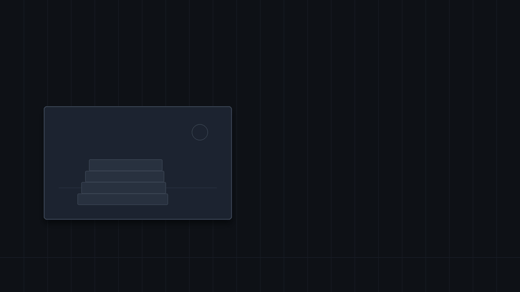
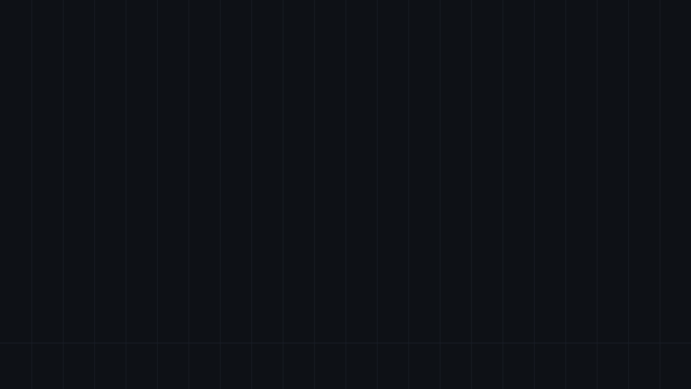

# Tsunagu-Pad

Pakai iPad sebagai layar sentuh untuk Ubuntu, dan tampilkan layar iPad di
Ubuntu. Semuanya berjalan di komputer sendiri melalui jaringan lokal. Tidak ada
data yang dikirim ke server mana pun, dan tidak ada aplikasi yang perlu dipasang
di iPad.

[English](README.md) | Bahasa Indonesia

## Demo



Layar Ubuntu tampil di iPad, dan sentuhan, Apple Pencil, mouse, serta keyboard
dari iPad mengendalikan Ubuntu. Menggambar di iPad langsung masuk ke aplikasi
yang berjalan di Ubuntu.



Di Wayland, iPad bisa jadi layar kedua, bukan salinan layar pertama: satu
monitor tanpa kabel, jendela bisa diseret ke sana, dan penunjuk menyeberang
seperti di layar biasa.


Arah sebaliknya: layar iPad tampil di Ubuntu lewat AirPlay, memakai tombol
Pencerminan Layar yang memang sudah ada di iPadOS.

Animasinya digambar oleh [docs/make_demo.py](docs/make_demo.py), bukan
rekaman layar sungguhan, jadi tidak ada isi layar pribadi yang ikut
dipublikasikan. Jalankan `python3 docs/make_demo.py` untuk membuatnya ulang.

## Fungsi

- **Bagikan layar Ubuntu ke iPad.** Monitor pilihan Anda di-encode dengan H.264
  perangkat keras lalu dikirim lewat WebRTC ke Safari. Sentuhan, Apple Pencil
  (dengan tekanan), trackpad, dan keyboard iPad mengendalikan Ubuntu.
- **Tampilkan layar iPad di Ubuntu.** Fitur Pencerminan Layar bawaan iPadOS
  diterima oleh UxPlay, penerima AirPlay sumber terbuka yang dipasang dari
  repositori Ubuntu.
- **Hotspot Wi-Fi langsung.** Titik akses virtual membuat iPad tersambung
  langsung ke laptop, sementara laptop tetap tersambung ke Wi-Fi biasa. Berguna
  di jaringan kampus atau kantor yang memblokir lalu lintas antar perangkat.
- **Satu tombol di GNOME Quick Settings.** Menyalakan, mematikan, memilih
  monitor, memilih kualitas, dan menampilkan QR sambungan dari menu sistem.

## Cara kerja

Program `tsunagupad` menangkap layar, meng-encode-nya menjadi H.264 dengan
NVENC, Intel VA-API, atau x264, lalu menyajikan dua hal di port 8765: halaman
web kecil untuk iPad dan kanal WebSocket untuk negosiasi WebRTC serta event
masukan. iPad menampilkan video di Safari dan mengirim balik event penunjuk,
pena, dan tombol.

- **Sesi Xorg:** area layar ditangkap lewat X11 dan masukan disuntikkan lewat
  XTest.
- **Sesi Wayland:** layar berasal dari aliran PipeWire portal ScreenCast
  xdg-desktop-portal, dan masukan penunjuk, gulir, serta keyboard lewat portal
  RemoteDesktop. GNOME meminta izin satu kali lalu mengingatnya.

Tekanan dan kemiringan Apple Pencil lewat perangkat tablet virtual di
`/dev/uinput`. Di Wayland tablet itu dipetakan ke monitor yang dibagikan.

Di Wayland penangkapan meminta GNOME paling banyak sebesar laju frame preset,
dan encoder Intel VA-API membaca frame sebagai DMA-BUF tanpa salinan lewat CPU.
Selama iPad tersambung, penguncian layar otomatis ditahan, karena GNOME menolak
sesi berbagi layar baru selama layar terkunci.

Latensi ditekan dengan tiga cara: encoder berjalan pada mode tanpa penundaan dan
hanya mengirim keyframe sepuluh detik sekali atau saat iPad memintanya, bitrate
menyesuaikan diri terhadap paket yang hilang menurut laporan iPad, dan penerima
diminta menampilkan setiap frame begitu selesai didekode alih-alih menyimpannya
di buffer.

## Kebutuhan

- Ubuntu 24.04 atau lebih baru dengan GNOME 45 sampai 50.
- Sesi Ubuntu on Xorg atau Wayland. Keduanya bisa; GNOME 50 (Ubuntu 26.04) hanya
  Wayland.
- iPad dengan Safari. Tidak perlu aplikasi dan tidak perlu jailbreak.
- Opsional: GPU NVIDIA atau Intel untuk encoding perangkat keras. Di NVIDIA
  Jetson dipakai encoder Tegra. Encoding perangkat lunak tersedia sebagai
  cadangan.

## Pemasangan

```bash
git clone https://github.com/khaichi11/tsunagu-pad.git
cd tsunagu-pad
chmod +x install.sh
./install.sh
```

Pemasang meminta kata sandi administrator satu kali. Ia memasang paket yang
dibutuhkan, membangun program, memasang program dan extension GNOME ke
`~/.local`, lalu menyiapkan layanan hotspot, aturan firewall, dan izin untuk
tekanan Apple Pencil.

Setelah itu muat ulang GNOME Shell: tekan `Alt+F2`, ketik `r`, lalu Enter. Pada
sesi Wayland, log out dan login kembali.

Untuk menghapus semuanya:

```bash
./uninstall.sh
```

## Pemakaian

Buka Quick Settings di pojok kanan atas, lalu pakai panah di sebelah tombol
Tsunagu-Pad untuk melihat pilihan.

### Bagikan layar Ubuntu

1. Pilih mode berbagi layar Ubuntu, lalu tentukan monitor dan kualitas. Di
   Wayland monitor dipilih di jendela izin GNOME.
2. Ketuk tombol Tsunagu-Pad. Di Wayland, GNOME menampilkan jendela izin pada
   pertama kali: pilih layar, nyalakan **Allow Remote Interaction** agar iPad
   bisa mengontrol Ubuntu, dan biarkan **Remember This Selection** menyala.
   Pilihan layarnya ikut diingat, itu sebabnya jendela izinnya tidak muncul
   lagi dan layar yang dibagikan selalu sama. Untuk memilih layar lain, pakai
   **Pilih layar lagi** di panel, atau jalankan sekali
   `tsunagupad share --pick-screen`.
3. Pindai QR dengan kamera iPad, atau ketik alamatnya di Safari.
4. Opsional: di Safari pilih Bagikan, lalu Tambahkan ke Layar Utama, supaya
   halaman terbuka layar penuh seperti aplikasi.

Di iPad, jari berfungsi sebagai mouse: ketuk untuk klik, tahan atau ketuk dua
jari untuk klik kanan, geser dua jari untuk menggulir. Apple Pencil menggambar
dengan tekanan, yang bekerja di aplikasi seperti Xournal++ dan Krita. Menu kecil
di bagian atas layar berisi keyboard, mode sentuh, pilihan bahasa, dan informasi
sambungan.

### Pakai iPad sebagai layar kedua

Hanya di Wayland. Layarnya datang dari monitor virtual kompositor, dan Xorg
tidak punya itu, jadi di sesi Xorg perintahnya berhenti dengan pesan, bukan
jalan setengah-setengah; panelnya pun menyembunyikan sakelar itu di sana. Kalau
sedang di Xorg, keluar lalu masuk lagi dan pilih Ubuntu on Wayland, atau
bagikan saja layar yang sudah ada.

```bash
tsunagupad share --second 1280x800
```

GNOME mendapat satu monitor tambahan yang tidak tercolok kabel apa pun. Jendela
bisa diseret ke sana, dan penunjuk dari laptop ikut menyeberang lalu digambar ke
dalam videonya, jadi rasanya seperti layar biasa. Atur sekali posisinya di
Pengaturan, Tampilan, dan GNOME mengingat letaknya.

Ukuran yang diminta itulah luas desktop yang didapat iPad. `--scale` mengatur
besar tampilannya: bawaannya `1`, jadi layar 1280x800 benar-benar seluas 1280
kali 800 titik; `1.5` membuat tulisan lebih besar dengan ruang dua pertiganya;
`ikut` menyamakan dengan skala monitor utama. Kalau ada aplikasi yang tidak mau
muat, beri layar yang lebih luas (`--second 1640x1024`), bukan skala yang lebih
besar.

### Tampilkan layar iPad

1. Pilih mode AirPlay lalu ketuk tombolnya.
2. Di iPad, buka Pusat Kontrol, lalu Pencerminan Layar.
3. Pilih **Tsunagu-Pad Ubuntu**.

AirPlay dari iPad adalah aliran video dan audio satu arah. iPadOS tidak
mengizinkan komputer mengendalikan iPad dari jarak jauh.

### Hotspot langsung

Nyalakan hotspot di menu, lalu pindai QR Wi-Fi dengan kamera iPad. Hotspot
berjalan di titik akses virtual bernama `ap0`, sehingga sambungan Wi-Fi utama
tetap hidup dan internetnya ikut dibagikan ke iPad.

Karena radio Wi-Fi hanya bisa bekerja pada satu kanal, hotspot selalu mengikuti
kanal Wi-Fi utama dan berpindah bersamanya. Bila Wi-Fi utama memakai kanal DFS,
hotspot bersamaan tidak diizinkan oleh regulasi, dan panel menjelaskan apa yang
perlu dilakukan. Nama dan kata sandinya dibuat saat pemasangan dan bisa diubah
dari menu.

### Lewat Tailscale

Bila jaringan memblokir lalu lintas antar perangkat dan hotspot langsung tidak
memungkinkan, Tailscale bisa dipakai sebagai jalurnya. Pasang Tailscale di
Ubuntu dan aplikasi Tailscale di iPad, masuk ke tailnet yang sama, lalu buka
alamat `100.x.y.z` yang ditampilkan panel pada daftar alamat lain. Tsunagu-Pad
mengutamakan alamat Tailscale untuk QR bila tunnel-nya hidup.

```bash
sudo apt install tailscale
sudo tailscale up
```

Tidak ada yang perlu diubah lagi: kode akses tetap berlaku dan tidak ada port
yang perlu dibuka ke internet. Latensinya lebih tinggi daripada jaringan lokal,
terutama bila Tailscale tidak mendapat sambungan langsung dan memakai relay.
Arah AirPlay tidak bisa lewat Tailscale, karena iPadOS mencari penerima di
jaringan lokal.

### Di Jetson atau mesin lain tanpa layar

Layar kedua bekerja sama saja di NVIDIA Jetson: monitor virtualnya datang dari
kompositor, bukan dari keluaran kartu grafis, jadi tidak perlu ada layar yang
tercolok. Encoder Tegra dipilih otomatis kalau tersedia, dan monitor virtual itu
menjadi monitor utama bila memang tidak ada layar lain.

Yang tetap dibutuhkan adalah sesi Wayland GNOME yang berjalan di Jetson-nya.
Tanpa layar tercolok, sesi biasanya tidak mau jalan sendiri. Pilihannya: nyalakan
login otomatis lalu biarkan dummy HDMI murah tertancap di portnya, atau jalankan
sesi GNOME headless lewat GNOME Remote Desktop, kemudian jalankan perintahnya di
dalam sesi itu:

```bash
tsunagupad share --second 1280x800
```

Jalur ini belum diuji di perangkat Jetson sungguhan. Kalau encoder-nya tidak
ketemu, `--encoder cpu` tetap bisa dipakai, dan `TSUNAGUPAD_DEBUG=1` menampilkan
encoder apa saja yang sudah dicoba.

## Kualitas dan latensi

Tersedia empat pilihan, dari lebar 960 piksel pada 30 frame per detik sampai
resolusi asli pada 60 frame per detik. Bitrate dimulai sekitar 6 Mbit/s, naik
selama jaringan lega, dan turun cepat saat ada paket hilang, sehingga pilihan
paling tajam butuh beberapa detik untuk mencapai kualitas penuh.

Ketuk tombol info di menu iPad untuk melihat frame rate dan perkiraan jeda. Pada
jaringan yang lapang, jedanya sekitar 40 sampai 90 milidetik. Kanal Wi-Fi yang
ramai menambah jeda itu.

## Penyelesaian masalah

Memeriksa encoder dan penerima AirPlay:

```bash
~/.local/bin/tsunagupad probe
```

Memeriksa hotspot:

```bash
systemctl status tsunagupad-hotspot.service --no-pager
journalctl -u tsunagupad-hotspot.service -b -n 50 --no-pager -o cat
```

Memeriksa panel:

```bash
journalctl -b /usr/bin/gnome-shell | grep -i tsunagupad | tail -20
```

Program lama yang masih memegang port, misalnya setelah GNOME Shell dimuat
ulang, dihentikan otomatis saat Tsunagu-Pad dinyalakan kembali.

## Batasan

- **Bukan layar tambahan.** iPad menampilkan cermin dari monitor yang sudah ada,
  bukan menjadi monitor tambahan. Membuat monitor virtual dengan modul kernel
  `vkms` membuat Xorg membeku pada laptop dengan GPU hibrida Intel dan NVIDIA,
  sehingga jalur itu dihapus. Cara yang andal untuk layar tambahan adalah
  adaptor dummy HDMI atau USB-C, lalu pilih monitornya di menu.
- **Wayland butuh jendela izin GNOME satu kali.** Tanpa **Allow Remote
  Interaction** iPad hanya bisa menonton. Tekanan Apple Pencil butuh tablet
  virtual yang dipetakan ke monitor yang dibagikan lewat pengaturan GNOME; bila
  gagal, Pencil bekerja sebagai penunjuk biasa.
- **Satu iPad sekaligus.** Sambungan baru menggantikan yang lama.

## Keamanan

- QR dan alamat sambungan memuat kode akses. Siapa pun yang memilikinya dapat
  melihat dan mengendalikan layar Ubuntu, jadi jangan dibagikan.
- Kata sandi hotspot disimpan di `/etc/tsunagupad/hotspot.conf`, hanya bisa
  dibaca root dan pengguna yang memasang program.
- Hotspot menjalankan DHCP dan NAT pada `10.88.0.0/24`. Nilai IP forwarding
  dikembalikan seperti semula saat hotspot dimatikan.
- Port yang dibuka di UFW: `8765/tcp` untuk halaman, `50000` sampai `50100/udp`
  untuk video, serta port AirPlay `7000,7001,7100/tcp` dan
  `6000,6001,7011,5353/udp`.

## Penafian

Ini proyek eksperimental yang dibuat untuk kesenangan sendiri, diberikan gratis
dan tanpa jaminan apa pun. Pemakaian sepenuhnya menjadi tanggung jawab Anda.

Pemasang mengubah pengaturan sistem: memasang paket, menambah layanan hotspot,
membuka port firewall, melonggarkan izin `/dev/uinput` untuk grup `input`, dan
menulis aturan polkit. Berbagi layar memberi kendali penuh atas desktop kepada
siapa pun yang memegang kode akses, dan hotspot membuat jaringan Wi-Fi dari
komputer Anda. Periksa dulu isi skripnya sebelum dijalankan, dan pastikan
pemakaian seperti ini diizinkan di jaringan yang Anda pakai.

Penulis dan kontributor tidak bertanggung jawab atas kerusakan, kehilangan data,
gangguan layanan, insiden keamanan, atau pelanggaran kebijakan yang timbul dari
pemakaian perangkat lunak ini, sebagaimana dinyatakan dalam Lisensi MIT.

## Kontribusi

Issue dan pull request dipersilakan. Commit mengikuti
[Conventional Commits](https://www.conventionalcommits.org/), misalnya
`feat(hotspot): follow the uplink channel`. Pertahankan gaya kode di sekitarnya
dan jelaskan cara Anda mengujinya.

## Lisensi dan merek

Kode di repository ini memakai [Lisensi MIT](LICENSE). Komponen pihak ketiga
tetap memakai lisensinya masing-masing; lihat
[THIRD_PARTY_NOTICES.md](THIRD_PARTY_NOTICES.md).

Apple, iPad, iPadOS, Safari, Apple Pencil, dan AirPlay adalah merek Apple Inc.
Proyek ini tidak berafiliasi, tidak didukung, dan tidak disponsori oleh Apple
Inc., serta tidak memuat perangkat lunak, gambar, maupun merek Apple di
berkasnya sendiri. Penerimaan AirPlay dikerjakan UxPlay, program terpisah yang
Anda pasang dari distribusi Anda; repository ini tidak menyertakannya.
