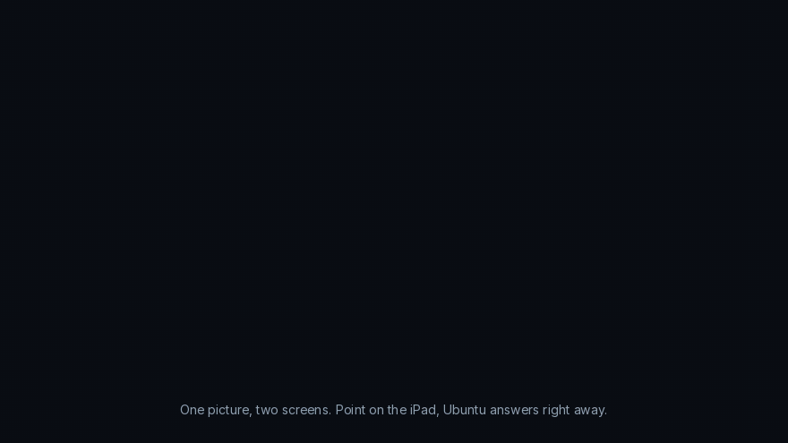

# Tsunagu-Pad

Use an iPad as a touch display for Ubuntu or Windows, and show the iPad screen
on the computer. Everything runs on your own machine over the local network.
Nothing is uploaded to any server, and no app has to be installed on the iPad.

Windows users: see [Windows](#windows) for the installer and the tray panel.

English | [Bahasa Indonesia](README.id.md)

## Demo



The Ubuntu screen appears on the iPad, and touch, Apple Pencil, mouse, and
keyboard from the iPad drive Ubuntu. Drawing on the iPad lands in the Ubuntu
application at once.


On Wayland the iPad can be a second screen instead of a copy of the first one:
a monitor with no cable, with windows dragged onto it and the pointer crossing
over as on any other screen.


The other direction: the iPad screen is shown on Ubuntu through AirPlay, using
the Screen Mirroring button that iPadOS already has.

The animations are drawn by [docs/make_demo.py](docs/make_demo.py), not
recorded from a real desktop, so no private screen content is published here.
Run `python3 docs/make_demo.py` to rebuild them.

## What it does

- **Share the Ubuntu screen to the iPad.** A monitor of your choice is encoded
  with hardware H.264 and sent over WebRTC to Safari. Touch, Apple Pencil (with
  pressure), trackpad, and keyboard input are forwarded back to Ubuntu.
- **Show the iPad screen on Ubuntu.** The built in Screen Mirroring of iPadOS is
  received through UxPlay, an open source AirPlay receiver installed from the
  Ubuntu repositories.
- **Direct Wi-Fi hotspot.** A virtual access point lets the iPad connect straight
  to the laptop while the laptop stays connected to its normal Wi-Fi network.
  Useful on campus or office networks that block device to device traffic.
- **One control in GNOME Quick Settings.** Start, stop, pick the monitor, pick
  the quality, and read the connection QR code from the system menu.

## How it works

The `tsunagupad` daemon captures the screen, encodes it to H.264 with NVENC,
Intel VA-API, or x264, and serves two things on port 8765: a small web page for
the iPad and a WebSocket channel used for WebRTC signalling and input events.
The iPad renders the stream in Safari and sends pointer, pen, and key events
back.

- **Xorg session:** the screen region is captured with X11 and input is
  injected through XTest.
- **Wayland session:** the screen comes from the PipeWire stream of the
  xdg-desktop-portal ScreenCast portal, and pointer, scroll, and keyboard input
  goes through the RemoteDesktop portal. GNOME asks for permission once and
  remembers it.

Apple Pencil pressure and tilt go through a virtual tablet device on
`/dev/uinput`. On Wayland that tablet is mapped to the shared monitor.

On Wayland the capture asks GNOME for at most the preset frame rate, and Intel
VA-API encoders read the frames as DMA-BUF without a copy through the CPU.
While an iPad is connected, the automatic screen lock is held off, because GNOME
refuses new screen sharing sessions while the screen is locked.

Latency is kept low in three ways: the encoder runs in a zero latency mode and
sends a keyframe only every ten seconds or when the iPad asks for one, the
bitrate adapts to packet loss reported by the iPad, and the stream asks the
receiver to display each frame as soon as it is decoded instead of buffering
it.

## Requirements

- Ubuntu 24.04 or newer with GNOME 45 to 50.
- An Ubuntu on Xorg or a Wayland session. Both work; GNOME 50 (Ubuntu 26.04) is
  Wayland only.
- An iPad with Safari. No app and no jailbreak needed.
- Optional: an NVIDIA or Intel GPU for hardware encoding. On NVIDIA Jetson the
  Tegra encoder is used. Software encoding works as a fallback.

## Install

On Windows, see [Windows](#windows). On Ubuntu:

Download `tsunagupad_<version>_amd64.deb` from the
[releases page](https://github.com/khaichi11/tsunagupad/releases) and open it,
or install it from a terminal:

```bash
sudo apt install ./tsunagupad_0.2.0_amd64.deb
```

That is the whole installation. Everything the program needs is listed as a
dependency of the package, so anything missing is fetched for you, with the
usual progress bar in App Center or the usual list in apt. The hotspot gets its
own random password on first install, and the terminal prints it.

Afterwards, log out and log in again once, then turn the panel switch on:

```bash
gnome-extensions enable tsunagu-pad@local
```

### Or build it yourself

```bash
git clone https://github.com/khaichi11/tsunagupad.git
cd tsunagupad
chmod +x install.sh
./install.sh            # builds and installs into ~/.local
tool/build_deb.sh       # or build the .deb instead
```

The installer asks for the administrator password once. It installs the packages
it needs, builds the daemon, installs the program and the GNOME extension into
`~/.local`, and sets up the hotspot service, the firewall rules, and the
permission for Apple Pencil pressure.

Reload GNOME Shell afterwards: press `Alt+F2`, type `r`, then Enter. On a Wayland
session, log out and log in again.

To remove everything:

```bash
./uninstall.sh
```

## Usage

Open Quick Settings in the top right corner and use the arrow next to the
Tsunagu-Pad button for the options.

### Share the Ubuntu screen

1. Select the mode for sharing the Ubuntu screen, then pick the monitor and the
   quality. On Wayland the monitor is chosen in the GNOME permission window.
2. Tap the Tsunagu-Pad button. On Wayland, GNOME shows a permission window the
   first time: pick the screen, turn on **Allow Remote Interaction** so the iPad
   can control Ubuntu, and keep **Remember This Selection** on. The choice is
   remembered, which is why the window does not appear again and the same
   screen is shared every time. To pick a different screen, use **Pilih layar
   lagi** in the panel, or run `tsunagupad share --pick-screen` once.
3. Scan the QR code with the iPad camera, or type the address into Safari.
4. Optional: in Safari use Share, then Add to Home Screen, so the page opens
   full screen like an app.

On the iPad, a finger acts as a mouse: tap to click, hold or tap with two
fingers to right click, drag two fingers to scroll. Apple Pencil draws with
pressure, which works in apps such as Xournal++ and Krita. A small menu at the
top of the screen holds the keyboard, the touch mode, the language, and the
connection info.

### Use the iPad as a second screen

Wayland only. The screen comes from the compositor's virtual monitor, which
Xorg does not have, so on an Xorg session the command stops with a message
instead of starting; the panel hides the switch there as well. If you are on
Xorg, log out and pick Ubuntu on Wayland at the login screen, or share the
screen you already have.

```bash
tsunagupad share --second 1280x800
```

GNOME gains a monitor that no cable is attached to. Windows can be dragged onto
it, and the pointer from the laptop crosses onto it and is drawn into the
picture, so it behaves like any other screen. Drag it into place once in
Settings, Displays, and the next session puts it back there: GNOME gives this
monitor a new serial number every time and so cannot match its own saved
layouts, which is why the position is kept in
`~/.config/tsunagupad/second-screen` instead.

The size is the desktop the iPad gets. `--scale` changes how large everything
on it looks: `1` by default, so a 1280x800 screen really is 1280 by 800 points
of room, `1.5` for larger text in two thirds of the room, or `ikut` to match
the scale of the main monitor. If an application refuses to fit, give it a
larger screen (`--second 1640x1024`) rather than a larger scale.

### Show the iPad screen

1. Select the AirPlay mode and tap the button.
2. On the iPad, open Control Center, then Screen Mirroring.
3. Choose **Tsunagu-Pad Ubuntu**.

AirPlay from an iPad is a one way video and audio stream. iPadOS does not allow
a computer to control the iPad remotely.

### Direct hotspot

Turn on the hotspot in the menu and scan the Wi-Fi QR code with the iPad camera.
The hotspot runs on a virtual access point named `ap0`, so the main Wi-Fi
connection stays up and internet access is shared with the iPad.

Because a Wi-Fi radio can only work on one channel at a time, the hotspot always
follows the channel of the main Wi-Fi connection and moves with it. If the main
connection uses a DFS channel, a simultaneous hotspot is not allowed by
regulation and the panel explains what to do. The name and the password are
generated during installation and can be changed from the menu.

### Over Tailscale

If the network blocks device to device traffic and the direct hotspot is not an
option, Tailscale works as the transport. Install Tailscale on Ubuntu and the
Tailscale app on the iPad, sign both into the same tailnet, then open the
`100.x.y.z` address that the panel lists under the other addresses. Tsunagu-Pad
prefers the Tailscale address for the QR code when the tunnel is up.

```bash
sudo apt install tailscale
sudo tailscale up
```

Nothing else needs to change: the access key still applies, and no port has to
be exposed to the internet. Expect more latency than on a local network,
especially when Tailscale cannot reach a direct connection and falls back to a
relay. The AirPlay direction does not work over Tailscale, because iPadOS looks
for the receiver on the local network.

### On a Jetson or another machine without a screen

The second screen works the same on an NVIDIA Jetson: the virtual monitor comes
from the compositor, not from a graphics card output, so no display has to be
plugged in. The Tegra encoder is picked automatically when it is present, and
the virtual monitor becomes the primary one when nothing else is attached.

What it does need is a running GNOME Wayland session on the Jetson. With no
display attached, a session usually does not start on its own. Either enable
automatic login and leave a cheap HDMI dummy plug in the port, or start a
headless GNOME session with GNOME Remote Desktop, then run the command inside
that session:

```bash
tsunagupad share --second 1280x800
```

This path has not been tested on Jetson hardware here. If the encoder is not
found, `--encoder cpu` still works, and `TSUNAGUPAD_DEBUG=1` prints which
encoders were tried.

To use the iPad as a replacement monitor, an Xorg session is enough and no dummy
plug is needed. With a monitor still plugged in, run `make login-setup` from a
terminal on the desktop: Xorg then always has a 1080p screen using that monitor's
EDID, and the GDM login screen also appears on the iPad, so the password is typed
there. The QR code will not be visible without a screen, so save the address to
the iPad Home Screen first. The **iPad aktif di sesi berikutnya** switch in the
panel decides whether this starts at the next login, and `make login-undo`
reverts everything.

Input from the iPad, including that password, travels encrypted and
authenticated (see [Security](#security)). Still, use a network you own with a
strong Wi-Fi password.

Options that cannot work are hidden automatically: `tsunagupad capabilities`
prints the machine model and what was detected. The hotspot only appears when
the Wi-Fi chip can be an access point while staying connected, and the encoder
is chosen by trying each one on that machine.

## Windows

The same program runs on Windows 10 (version 1809 or newer) and Windows 11,
64-bit. Every feature of the Ubuntu version has a Windows counterpart:

| Ubuntu | Windows |
|---|---|
| GNOME Quick Settings button | Icon next to the clock, kept visible beside Quick Settings, opening a panel built like Windows 11 Quick Settings (also `Ctrl+Alt+I`) |
| Capture through X11 or PipeWire | DXGI Desktop Duplication, on the GPU |
| NVENC, Intel VA-API, x264 | NVENC, Intel Quick Sync, AMD AMF, Media Foundation, x264 |
| Pen as a uinput tablet | Pen as a Windows Ink pen, with pressure (1024 levels) and tilt |
| Second screen from Mutter's virtual monitor | Second screen from the Virtual Display Driver, a monitor with no cable |
| UxPlay from the Ubuntu repositories | UxPlay built in and bundled, with its own mDNS, so Apple Bonjour is not needed |
| Hotspot on a virtual `ap0` | Windows Mobile Hotspot, which also keeps the main Wi-Fi connected |
| `make login-setup`, systemd user service | The Tsunagu-Pad service: the sign-in screen and the next session on the iPad |
| UFW rules | Windows Firewall rules for the local subnet and Tailscale only |

### Install on Windows

Download `Tsunagu-Pad-<version>-setup.exe` from the
[releases page](https://github.com/khaichi11/tsunagupad/releases) and run it.
The installer carries everything it needs, so nothing is downloaded during
installation. It asks for the administrator password once and offers four parts:

- **Tsunagu-Pad** (required): the program, the tray panel, the iPad page,
  AirPlay, and Windows Firewall rules that accept only the local subnet and
  Tailscale (`100.64.0.0/10`).
- **Second screen**: installs the Virtual Display Driver (MIT licensed, signed
  by SignPath Foundation for the Virtual Display Driver project). Windows may
  ask once whether to install this device software.
- **Sign-in screen and next session**: a Windows service that does nothing
  until the switch in the panel is turned on.
- **`tsunagupad` in PATH**, for use from a terminal or over SSH. Only a small
  folder with a launcher goes into PATH, not the folder with the program's
  libraries, so other programs never load them by accident.

A portable `.zip` is also published for machines where installing is not
possible; it has the program and AirPlay, but not the driver, the service, or
the firewall rules.

### Use on Windows

Windows does not let other applications add tiles to its Quick Settings
panel, so Tsunagu-Pad brings a panel that works the same way. Its icon sits
next to the clock, beside the Quick Settings icons, and the installer keeps it
visible instead of under the `^` arrow. Click it, or press `Ctrl+Alt+I`
anywhere. Everything is in that one panel, which scrolls when the screen is
short:

- the switch at the top turns Tsunagu-Pad on and off, with the status under
  the name;
- **Windows ke iPad** or **iPad ke Windows** chooses the direction;
- when sharing, the QR code to scan with the iPad camera, the addresses, and
  buttons to copy the address or make a new access key;
- **Layar**: the second screen switch with its size and scale, the monitor to
  share, and the quality preset;
- **Hotspot**: the hotspot switch, its Wi-Fi QR code, and its name and
  password, edited right in the panel;
- **Lainnya**: the next session and sign-in screen, starting at sign-in, and
  quitting.

Right-clicking the icon opens the same panel; there are no separate menus. The
panel follows the dark or light theme of Windows. The Start menu also has
*Tsunagu-Pad - Nyalakan atau matikan*, which can be pinned to Start or to the
taskbar for a one click switch. The *Mobile hotspot* tile that Windows already
has in Quick Settings controls the same hotspot that Tsunagu-Pad uses.

- **Second screen.** Turn on *Jadikan iPad layar kedua*. Windows gains a
  monitor while the iPad is connected and loses it again when Tsunagu-Pad
  stops; windows left on it move back to the other screens. Drag it into place
  once in Settings, System, Display, and the next session puts it back there.
  From a terminal: `tsunagupad share --second 1280x800 --scale 1.5`. A size the
  driver does not know yet is added by the service on first use.
- **AirPlay.** Choose *iPad ke Windows*, then on the iPad open Control Center,
  Screen Mirroring, and pick **Tsunagu-Pad Windows**. While the hotspot is on,
  the receiver is announced on the hotspot, where the iPad is.
- **Campus networks.** eduroam and similar networks keep devices apart, so the
  iPad cannot reach the laptop even on the same Wi-Fi. The panel says so when
  the laptop is on such a network: turn on the hotspot and join it from the
  iPad.
- **Hotspot.** *Hotspot langsung* turns on Windows Mobile Hotspot and the panel
  shows its Wi-Fi QR code. The name and password are changed right in the panel.
  Windows needs a Wi-Fi or Ethernet connection to share before it can start
  the hotspot.
- **Sign-in screen and next session.** *iPad aktif di sesi berikutnya* asks for
  the administrator password, then the service shares the screen at the sign-in
  screen, the lock screen, and UAC prompts, and keeps going after you sign in.
  It uses a copy of your access key, so the iPad shortcut keeps working. This
  is also how `tsunagupad on` works over SSH.
- **Apple Pencil** reaches applications as a Windows Ink pen with pressure and
  tilt, so Krita, Photoshop, OneNote, and Xournal++ draw with it as with a
  tablet. Input into windows that run as administrator (Task Manager, installer
  windows) is blocked by Windows unless the session comes from the service.

The command line is the same as on Ubuntu, plus a few Windows commands:

```
tsunagupad share [--monitor N|primary|\\.\DISPLAY2] [--second WxH] [--scale S] [--quality Q]
tsunagupad receive [--fullscreen]
tsunagupad on | off | status
tsunagupad hotspot on|off|status|config NAME   (password from standard input)
tsunagupad monitors
tsunagupad service status
tsunagupad probe
```

### Build for Windows yourself

Install [MSYS2](https://www.msys2.org), open the **UCRT64** terminal, install the
packages listed at the top of [windows/build.sh](windows/build.sh), then:

```bash
git clone https://github.com/khaichi11/tsunagupad.git
cd tsunagupad
windows/build.sh        # dist/windows/Tsunagu-Pad-<version>-setup.exe
```

The script builds the program and UxPlay, collects the GStreamer plugins and
DLLs, verifies the checksum of the Virtual Display Driver release, and runs
NSIS. GitHub Actions runs the same script on every push, installs the result
silently on a clean Windows machine, and tests the encrypted channel against
the installed program.

### Troubleshooting on Windows

- `tsunagupad probe` lists the encoder that works. `TSUNAGUPAD_DEBUG=1` prints
  each encoder that was tried and the GStreamer pipeline.
- No picture on the iPad: check that the network is the same, and that the
  Windows Firewall rules named *Tsunagu-Pad* exist (install again to restore
  them). Networks marked *Public* are allowed by the rules, but only from the
  local subnet.
- `tsunagupad service status` shows whether the service is installed and on.
- To remove everything, use Settings, Apps, Tsunagu-Pad, Uninstall. It removes
  the service, the firewall rules, the PATH entry, and the virtual display
  driver if Tsunagu-Pad installed it.

## Why it exists

I needed three things to be true at the same time: a screen the compositor
really owns on a Wayland session, nothing installed on the iPad, and an Apple
Pencil that reaches applications as a tablet with pressure and tilt rather than
as a mouse. Reaching all three meant solving a few things along the way: a
compositor that only repaints a virtual monitor when its contents change, a
cursor that is never drawn into the stream, and a monitor whose serial number
changes every session so the desktop forgets where it was placed.

## Quality and latency

Five presets are available, from 960 pixels wide at 30 frames per second up to
the native resolution at 60 frames per second. The `monitor` preset (up to 1920 pixels
wide, 30 frames per second) is meant for machines without a hardware encoder.
The bitrate starts around
6 Mbit/s, rises while the network is clear, and drops quickly when packets are
lost, so the sharpest preset needs a few seconds to reach full quality.

Tap the info button in the iPad menu to see the frame rate and the estimated
delay. Expect roughly 40 to 90 milliseconds on a quiet network. A busy shared
Wi-Fi channel adds more.

## Troubleshooting

Check the encoder and the AirPlay receiver:

```bash
~/.local/bin/tsunagupad probe
```

Check the hotspot:

```bash
systemctl status tsunagupad-hotspot.service --no-pager
journalctl -u tsunagupad-hotspot.service -b -n 50 --no-pager -o cat
```

Check the panel:

```bash
journalctl -b /usr/bin/gnome-shell | grep -i tsunagupad | tail -20
```

Old daemons that still hold a port, for example after a GNOME Shell reload, are
stopped automatically when Tsunagu-Pad starts again.

## Limitations

- **No extra desktop.** The iPad mirrors an existing monitor; it does not become
  an additional display. Creating a virtual monitor with the `vkms` kernel module
  froze Xorg on hybrid Intel and NVIDIA laptops, so that path was removed. A
  physical HDMI or USB-C dummy adapter plus the monitor selector is the reliable
  way to get an extra screen.
- **Wayland needs the GNOME permission window once.** Without **Allow Remote
  Interaction** the iPad can only watch. Apple Pencil pressure needs the virtual
  tablet to be mapped to the shared monitor, which is done through GNOME
  settings; if that fails, the Pencil acts as a plain pointer.
- **One iPad at a time.** A new connection replaces the previous one.

## Security

The same protections apply on Ubuntu and on Windows.

- **The access key never travels over the network.** The QR code carries it
  after `#` (`http://…:8765/#k=…`), the part of an address that a browser never
  sends to the server. When the iPad connects, the computer sends a random
  challenge and the iPad answers with HMAC-SHA256 of the key and both random
  values. Older shortcuts with `?k=` still work; the page moves the key behind
  `#` at once.
- **Everything on the connection is encrypted and authenticated.** Keys for
  this one connection are derived from the access key and the two random
  values. Every message, in both directions, is encrypted with ChaCha20 and
  carries an HMAC-SHA256 over its sequence number and content. A message that
  was changed, replayed, or reordered closes the connection. Typing, including
  a sign-in password, cannot be read by others on the network, commands cannot
  be injected, and the DTLS fingerprints of the WebRTC video are authenticated
  as well, so the video cannot be redirected. The implementation is
  [src/crypto.c](src/crypto.c) and [web/secure.js](web/secure.js), checked
  against the RFC test vectors and by [tool/test_channel.mjs](tool/test_channel.mjs)
  in CI. It does not protect against someone who can change the page itself on
  its way to the iPad, which is why a network you own matters.
- **Local networks only.** Only loopback, private (`10/8`, `172.16/12`,
  `192.168/16`), link-local, and Tailscale (`100.64/10`, `fc00::/7`) addresses
  are served. `--allow-public` lifts this when it is really needed.
- **Limits.** After five wrong keys within a minute, that address waits a
  minute. WebSocket connections from pages of other sites (a different
  `Origin`) are refused, messages are capped in size, and the page is served
  with a Content Security Policy, `nosniff`, `no-referrer`, and no framing.
- **You see who connects.** The panel (GNOME and Windows) shows a notification
  with the address of every new device that takes control, and **Buat kode
  akses baru** revokes the old key at once.
- The hotspot password is stored in `/etc/tsunagupad/hotspot.conf` on Ubuntu,
  readable only by root and the user who installed the program. On Windows it is
  the Mobile Hotspot setting of Windows itself.
- The Ubuntu hotspot runs DHCP and NAT on `10.88.0.0/24`. IP forwarding is
  restored to its previous value when the hotspot stops.
- Firewall: UFW on Ubuntu and Windows Firewall on Windows accept the page
  (`8765/tcp`), the video (`50000` to `50100/udp`), and AirPlay
  (`7000,7001,7100/tcp`, `6000,6001,7011,5353/udp`) only from private,
  link-local, and Tailscale addresses.
- Windows service: the copy of the access key and the session log live in
  `%ProgramData%\TsunaguPad\session`, readable only by SYSTEM and
  administrators. Turning the switch on or off needs administrator rights. The
  service accepts commands only from this computer, and only a fixed set of
  options (for example `--web-dir` is refused, so it cannot be told to serve
  arbitrary files).

## Disclaimer

This is an experimental hobby project, provided free of charge and without any
warranty. Use it at your own risk.

The installer changes system settings: it installs packages, adds a hotspot
service, opens firewall ports, relaxes the permission on `/dev/uinput` for the
`input` group, and writes a polkit rule. On Windows it adds firewall rules, and
when selected a virtual display driver, a service, and a PATH entry. Screen sharing gives anyone holding the
access key full control of your desktop, and the hotspot creates a Wi-Fi network
from your machine. Review the scripts before running them, and make sure this
kind of setup is allowed on the network you use.

The authors and contributors are not liable for any damage, data loss, downtime,
security incident, or policy violation resulting from the use of this software,
as stated in the MIT License.

## Contributing

Issues and pull requests are welcome. Commits follow
[Conventional Commits](https://www.conventionalcommits.org/), for example
`feat(hotspot): follow the uplink channel`. Please keep the style of the
surrounding code and describe how you tested the change.

## License and trademarks

The code in this repository is licensed under the [MIT License](LICENSE).
Third party components stay under their own licenses; see
[THIRD_PARTY_NOTICES.md](THIRD_PARTY_NOTICES.md), which also says plainly which
parts are standards implemented by other people and which parts are the work
claimed here.

Apple, iPad, iPadOS, Safari, Apple Pencil, and AirPlay are trademarks of Apple
Inc. Windows is a trademark of Microsoft Corporation. This project is not affiliated with, endorsed by, or sponsored by Apple
Inc., and contains no Apple software, artwork, or trademarks in its own files.
Receiving AirPlay is performed by UxPlay, a separate program: on Ubuntu you
install it from your distribution, and the Windows installer carries a build of
it with its license and source location. This repository does not contain it.
